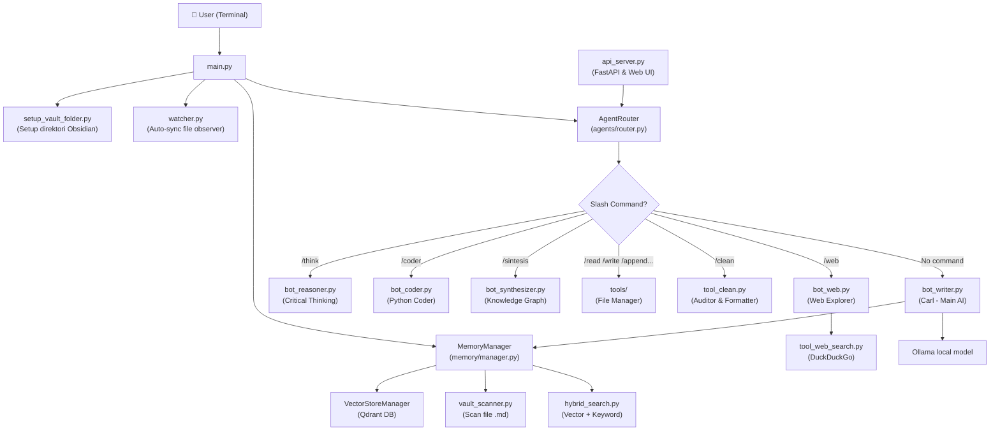
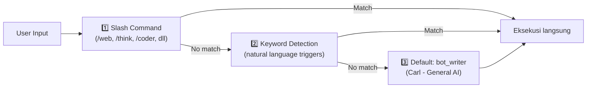

# 🧠 Analisa Project: Multi-Agent AI (Second Brain)

> **Pembaruan:** Dokumen ini diselaraskan dengan konfigurasi proyek yang aktif pada 2026-10-13. Stack runtime yang terlihat di `config.py` menggunakan Ollama lokal. Klaim OpenAI di dokumen versi lama tidak berlaku untuk konfigurasi saat ini.

> [!NOTE]
> Project ini adalah **Multi-Agent AI System** dengan CLI dan API FastAPI, berfungsi sebagai "Second Brain" pribadi, terintegrasi dengan **Obsidian Vault**, **Qdrant**, dan model lokal melalui **Ollama**.

---

## 📐 Arsitektur Sistem



---

## 📁 Struktur Folder

| Folder/File | Peran |
|:---|:---|
| `main.py` | Entry point — inisialisasi semua komponen & loop chat |
| `config.py` | Konfigurasi API key, path, model, dan parameter |
| `agents/` | Semua agent spesialis |
| `agents/router.py` | Router: menentukan agent mana yang dipanggil |
| `agents/__init__.py` | `AITeam` class — orkestrator semua agent |
| `memory/` | Manajemen memori: scan vault, vector DB, hybrid search |
| `tools/` | Tool operasional: baca/tulis/hapus/pindah/bersihkan file |
| `db/qdrantstorage/` | Data vektor lokal (Qdrant) — `collection: obsidian_vault` |
| `Flowchart/` | Diagram arsitektur (draw.io) |
| `watcher.py` | File system observer untuk auto-sync Obsidian |
| `setup_vault_folder.py` | Inisialisasi struktur folder Obsidian |
| `requirements.txt` | Daftar dependensi Python |

---

## 🤖 Daftar Agent

| Agent | File | Fungsi |
|:---|:---|:---|
| **Carl (Writer)** | `bot_writer.py` | Agent utama — menjawab pertanyaan dari konteks Obsidian |
| **Web Explorer** | `bot_web.py` | Riset internet via DuckDuckGo |
| **Reasoner** | `bot_reasoner.py` | Penalaran kritis & problem solving |
| **Coder** | `bot_coder.py` | Spesialis Python & skrip |
| **Synthesizer** | `bot_synthesizer.py` | Sintesis ide & knowledge graph |
| **Curator** | `bot_curator.py` | Kurasi & relokasi materi catatan |
| **File Manager** | `bot_file_manager.py` | Buat & kelola file Vault |
| **Cleaner** | `tool_clean.py` | Audit & perapihan format folder |

---

## 🛠️ Routing Logic (AgentRouter)

Sistem routing memiliki **3 lapisan prioritas**:



---

## 💾 Memory System

- **Embedding Model:** `nomic-embed-text` (Ollama)
- **Vector DB:** Qdrant (lokal di `db/qdrantstorage/`)
- **Collection:** `obsidian_vault`
- **Search:** Hybrid — Vector similarity + RRF ranking + lightweight lexical heuristic + wikilink graph retrieval
- **Auto-sync:** `watchdog` observer memantau perubahan file Obsidian secara real-time

---

## ⚙️ Konfigurasi (config.py)

| Parameter | Nilai |
|:---|:---|
| Model Writer | `qwen2.5:7b` |
| Model Reasoner | `deepseek-r1:8b` |
| Model Coder | `qwen2.5-coder:7b` |
| Model Embedding | `nomic-embed-text` |
| Vault Path | `E:/Project AI 2026/Obsidian/Brain AI Memory` |
| DB Path | `E:/Project AI 2026/Multi-Agent AI/db/qdrantstorage` |
| Temperature Writer | 0.3 |
| Temperature Reasoner | 0.6 |
| Temperature Coder | 0.2 |

> [!NOTE]
> `config.py` saat ini mengatur Ollama lokal dan tidak mendefinisikan `OPENAI_API_KEY`. Fitur integrasi eksternal tertentu tetap perlu diperiksa terpisah sebelum menyimpulkan bahwa seluruh proyek tidak memakai credential.

---

## ⚠️ Temuan & Catatan Penting

### 🟠 Catatan Validasi
1. Sistem menggunakan dependency lokal dan eksternal; ketersediaan Ollama/model dan service terkait perlu dipastikan saat runtime.
2. Query expansion telah diperbaiki agar hasil alternatif masuk ke hybrid ranking; benchmark retrieval masih sintetis dan tidak mengukur akurasi jawaban LLM.
3. Evaluasi jawaban memerlukan dataset acuan yang ditinjau manusia; lihat `evaluation/README.md`.

### 🟡 Potensi Peningkatan
4. **Kualitas routing harus terus diuji** — heuristic menjalankan fast path, kemudian classifier menangani intent inti; fitur lain tetap bisa dipanggil dengan slash command.
5. **Error handling** — Jalur retrieval kini mencatat kegagalan Qdrant dan mempertahankan fallback lexical/graph dengan peringatan; endpoint/agent lain tetap memerlukan pengujian.

### 🟢 Kekuatan Desain
- Arsitektur modular: setiap agent berdiri sendiri dan mudah diextend.
- Routing 3-layer cerdas (command → keyword → default).
- Hybrid search (vector + keyword) meningkatkan kualitas retrieval.
- Auto-sync Obsidian via `watchdog` sangat efisien.
- UI terminal yang rapi menggunakan `rich`.

---

## 📦 Dependensi Proyek

Daftar dependency yang dipelihara proyek ada di `requirements.txt`. Runtime yang dikonfigurasi pada `config.py` menggunakan:

```
ollama
langchain
langchain-community
langchain-ollama
langchain-text-splitters
langchain-qdrant
qdrant-client
fastapi
uvicorn
duckduckgo-search
watchdog
```

Daftar ini ringkas untuk komponen utama, bukan pengganti manifest dependency proyek.
