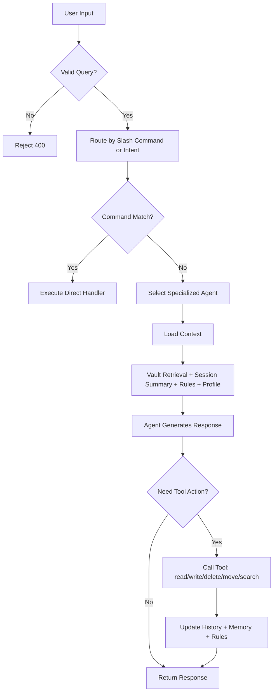
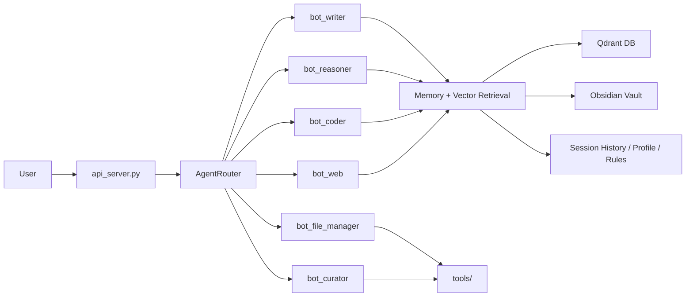
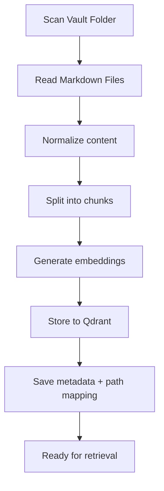
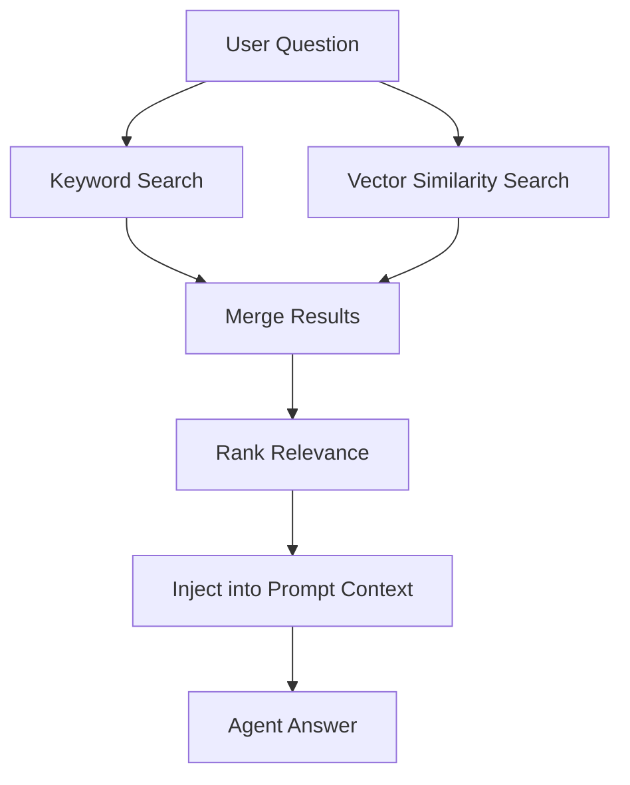
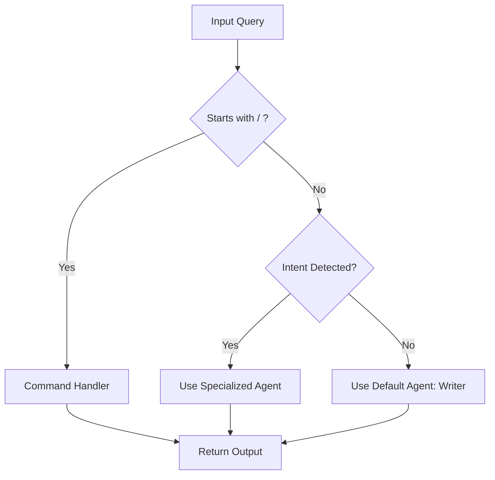

# Diagram Algoritma Sistem Multi-Agent AI Second Brain

## 1. Diagram Alur Sistem



---

## 2. Diagram Arsitektur Komponen



---

## 3. Diagram Indexing Vault



---

## 4. Diagram Retrieval Query



---

## 5. Diagram Logika Agent Selection



---

## 6. Ringkasan Sederhana

```text
Ambil input
  ↓
Validasi
  ↓
Routing
  ↓
Konteks + memory retrieval
  ↓
Agent per task
  ↓
Tool jika dibutuhkan
  ↓
Update memory history
  ↓
Respons final
```

---

## 7. Interpretasi Inti

Sistem ini bekerja seperti orkestrasi kognitif: input masuk, dipilah, dihubungkan ke memori, dipetakan ke agent yang tepat, dan menghasilkan jawaban atau aksi. Struktur ini membuat system lebih mirip "assistant yang punya memory + tools + task routing" dibanding hanya model statis.
