# 🌌 Master Plan 2.0: Evolusi Tingkat Lanjut Menuju "Autonomous Cognitive Partner"

> **Latar Belakang:**  
> Sistem saat ini telah memiliki fondasi **Level 3 (Knowledge-Augmented AI)** dengan *Graph RAG (asosiasi wikilinks)*, *Dynamic Profiling*, *Deep Web Reader*, dan *Cognitive Reflection*.  
> Langkah berikutnya adalah membawa sistem menuju **Level 4 & 5 (Autonomous Agentic System)**: AI yang bisa **bekerja mandiri dalam beberapa tahap (multi-step)**, **berdebat internal antar model spesialis**, **mempelajari aturan kerja baru (procedural memory)**, dan **sadar tenggat waktu (temporal intelligence)**.

---

## 🧭 Diagram Arsitektur Kecerdasan Masa Depan (Next Leap)

```mermaid
flowchart TD
    subgraph Core["🧠 Cognitive Core (Saat Ini Aktif)"]
        A[Hybrid RRF Search] --- B[Graph RAG 1-Hop]
        B --- C[Dynamic Profiling]
        C --- D[Deep Web Reader]
    end

    subgraph Leap1["⚡ 1. Autonomous Goal Engine (ReAct)"]
        E["Perintah Kompleks<br/>(Riset + Tulis + Link)"] --> F["Perencanaan Langkah (Planner)"]
        F --> G["Loop Eksekusi Mandiri"]
    end

    subgraph Leap2["👥 2. Council of Experts (Internal Debate)"]
        H["Dilema / Strategi Bisnis"] --> I["DeepSeek-R1: Devil's Advocate"]
        I <--> J["Qwen-Coder: Kelayakan Teknis"]
        J --> K["Carl: Sintesis Solusi Matang"]
    end

    subgraph Leap3["📜 3. Procedural Memory (Rule Learning)"]
        L["User: 'Mulai sekarang kalau buat catatan harus ada...'"] --> M["Rule Registry Engine"]
        M --> N["Otomatis Terapkan di File Baru"]
    end

    subgraph Leap4["⏰ 4. Temporal & Vault Lifecycle"]
        O["Deadline & Task Scanner"] --> P["Morning Briefing & Weekly Review"]
        P --> Q["Otomasi Daily Notes"]
    end

    Core ==> Leap1
    Core ==> Leap2
    Core ==> Leap3
    Core ==> Leap4
```



---

## 🔍 Analisis Kesenjangan (Gap Analysis): Kondisi Sekarang vs Level Selanjutnya

| Dimensi | Kondisi Saat Ini (Telah Aktif) | Target Level Selanjutnya (Next Leap) |
| :--- | :--- | :--- |
| **Alur Eksekusi** | **1-Turn Single Action** (1 chat $\rightarrow$ 1 aksi $\rightarrow$ selesai). | **Autonomous Multi-Step Loop** (1 perintah $\rightarrow$ rantai aksi mandiri hingga selesai). |
| **Kolaborasi Agen** | **Terpisah** (User memilih tanya Carl, Coder, atau Reasoner). | **Internal Debate Mode** (DeepSeek-R1 dan Qwen berdiskusi di balik layar sebelum menjawab). |
| **Memori Aturan** | **Faktual & Profil** (Mengingat nama, minat, proyek aktif). | **Prosedural (SOP Learning)** (Mempelajari dan menerapkan cara kerja baru dari perintah user). |
| **Kesadaran Waktu** | **Timestamp Statis** (Tahu hari dan jam sekarang). | **Temporal Intelligence** (Memindai deadline catatan dan membuat Morning Briefing). |
| **Eksekusi Kode** | **Hanya Menghasilkan Teks Markdown** (User harus copy-paste). | **Safe Local Code Runner** (AI bisa menguji kode Python kecilnya sendiri untuk memastikan tidak ada bug). |

---

## 🎯 5 Fitur Unggulan untuk Peningkatan Selanjutnya

### 1. 🔄 Autonomous Multi-Step Goal Engine (ReAct Loop)
* **Konsep:** Kemampuan AI untuk mengeksekusi perintah multi-tahap secara otonom.
* **Skenario:**  
  Anda berkata: *"Carl, tolong cari tahu tren AI di 2026, lalu buat catatan baru tentang itu di 01-Projects, dan link ke catatan Strategi Marketing 2026."*
* **Mekanisme Otomatis:**
  1. `Step 1`: AI memanggil Web Explorer untuk riset mendalam.
  2. `Step 2`: AI merumuskan sintesis dan membuat file `01-Projects/Tren AI 2026.md`.
  3. `Step 3`: AI membuka `01-Projects/Strategi Marketing 2026.md` dan menambahkan backlink `[[Tren AI 2026]]`.
  4. `Step 4`: AI melapor ke Anda bahwa seluruh rantai tugas selesai!

---

### 2. 🏛️ Council of Experts: Multi-Agent Internal Debate (`/council`)
* **Konsep:** Sebelum menjawab keputusan bisnis/strategis yang rumit, model-model lokal berdebat di balik layar untuk membedah solusi bebas bias.
* **Mekanisme:**
  - **DeepSeek-R1 (Devil's Advocate):** Mencari 3 risiko terburuk, celah hukum/finansial, dan skenario kegagalan.
  - **Qwen-Coder (Praktisi):** Menganalisis efisiensi implementasi teknis.
  - **Carl / Qwen2.5 (Synthesizer):** Merangkum kesimpulan final yang sudah tahan uji risiko untuk diserahkan ke Anda.

---

### 3. 📜 Procedural Memory & SOP Learning (AI yang Bisa Diajari Aturan)
* **Konsep:** Menyimpan aturan operasional kustom yang diajarkan oleh Anda ke dalam file `db/.system_rules.json`.
* **Skenario:**  
  Anda berkata: *"Carl, mulai sekarang setiap buat catatan proyek, selalu sertakan tabel anggaran dan target KPI."*
* **Mekanisme:**
  - AI mendeteksi bahwa ini adalah perintah aturan (*procedural instruction*).
  - Aturan dicatat secara permanen di memori sistem.
  - Ke depannya, setiap kali tool pembuat catatan dipanggil, aturan ini otomatis diterapkan tanpa Anda harus mengulang perintah.

---

### 4. ⏰ Temporal Intelligence & Vault Daily Briefing (`/briefing`)
* **Konsep:** Menghubungkan kalender dan tenggat waktu catatan Obsidian dengan rutinitas Anda.
* **Mekanisme:**
  - **Deadline Scanner:** Memindai tag `deadline: YYYY-MM-DD` atau checkbox tugas `- [ ]` yang belum selesai di seluruh vault.
  - **Morning Briefing:** Saat Anda mengetik `/briefing` atau menyapa di pagi hari, Carl memberikan ringkasan:
    - Apa proyek yang sedang berjalan?
    - Apakah ada catatan yang belum disentuh lebih dari 7 hari?
    - Saran 3 fokus utama untuk hari ini.
  - **Auto Daily Note Log:** Opsi untuk menyalin poin penting obrolan langsung ke `05-Daily Notes/YYYY-MM-DD.md`.

---

### 5. 🧪 Safe Local Code Sandbox Runner (`/run_code`)
* **Konsep:** Agen Coder tidak hanya mengetik teks kode, tetapi bisa mengeksekusi skrip Python sederhana di sandbox aman.
* **Mekanisme:**
  - Menjalankan kode via subprocess terisolasi.
  - Jika ada *error* (misal ImportError atau TypeError), Coder membaca pesan *error*, memperbaiki kodenya sendiri (*self-debug*), dan baru memberikan kode yang 100% terbukti berjalan kepada Anda.

---

## 🗺️ Roadmap Eksekusi Tingkat Lanjut

```
[Tahap A: Autonomous Engine]
  ├── Bangun ReAct Goal Planner (Multi-step tool execution)
  └── Integrasikan perintah kompleks multi-agent

[Tahap B: Council Debate & Procedural Rules]
  ├── Pasang mode /council (DeepSeek-R1 vs Qwen debate)
  └── Buat modul Procedural Rules (.system_rules.json)

[Tahap C: Temporal Intelligence]
  ├── Pasang Scanner Task & Deadline di Vault
  └── Bangun fitur /briefing & integrasi Daily Notes
```

---

> [!TIP]
> Prioritas yang paling terasa dampaknya bagi kepintaran harian adalah **Tahap A (Autonomous Multi-Step Goal Engine)** dan **Tahap B (Council Debate & Procedural Rules)**.
