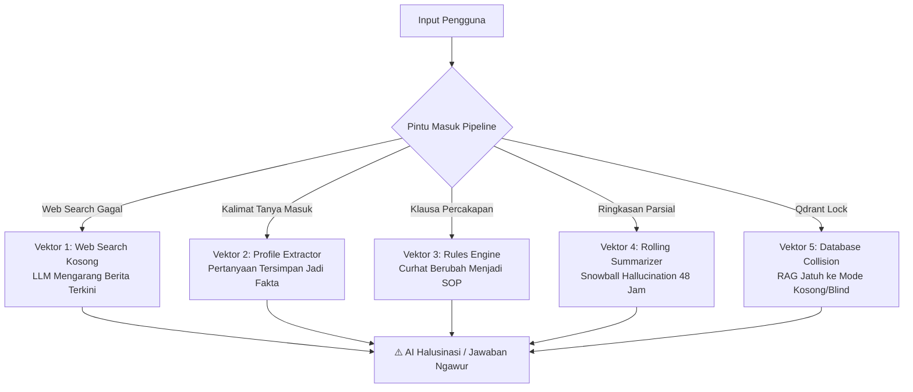
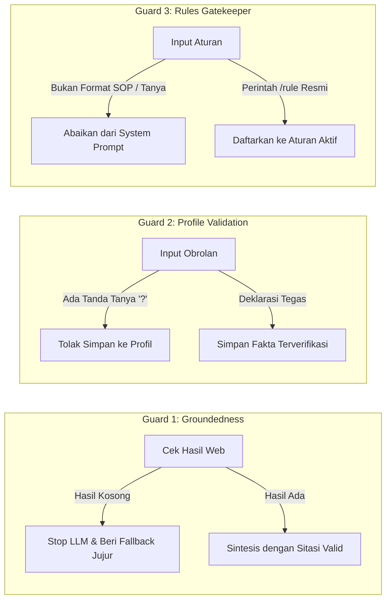

# 📑 Laporan Audit Sistemik: Mitigasi Halusinasi, Kesalahan Logika, & Respon Ngawur AI

> **Status Dokumen:** Aktif / Final Analisis  
> **Target Sistem:** Carl Multi-Agent AI (Level 5 Omnipresent Second Brain)  
> **Tanggal Audit:** 13 Oktober 2026  
> **Cakupan:** Memory Engines, Tool Integrations, RAG Context, Router Heuristics, & Guardrails  

---

## 🎯 Ringkasan Eksekutif

Audit ini dilakukan secara menyeluruh terhadap seluruh arsitektur proyek untuk mengidentifikasi akar penyebab mengapa model bahasa lokal (Local LLM / SLM seperti DeepSeek-R1, Qwen2.5, Llama-3) terkadang menghasilkan **jawaban halusinasi (*halu*)**, **keliru menafsirkan fakta catatan**, atau **merespons secara tidak tepat (*ngawur*)**.

Laporan ini merinci 5 vektor kerentanan utama, audit terhadap 10 *tools* inti, rencana arsitektur *anti-hallucination guardrails*, serta analisis kritis mengenai dampak perubahan (*trade-offs*) terhadap akurasi dan pengalaman pengguna.

---

## 🚨 1. Vektor Kerentanan: Mengapa AI Mengarang Jawaban?



### 1.1 Web Search Kosong $\rightarrow$ AI Tetap Disuruh Meringkas Berita Terkini
* **Lokasi Berkas:** [`agents/bot_web.py`](file:///e:/Project%20AI%202026/Multi-Agent%20AI/agents/bot_web.py) & [`tools/tool_web_search.py`](file:///e:/Project%20AI%202026/Multi-Agent%20AI/tools/tool_web_search.py)
* **Mekanisme Kegagalan:**
  1. Pengguna meminta: *"Apa berita teknologi hari ini?"*
  2. Mesin pencari (DuckDuckGo HTML) gagal mengambil data (misal: koneksi offline, rate limit, atau selector HTML berubah), sehingga `web_search_structured()` mengembalikan `web_context = "⚠️ Tidak ditemukan hasil pencarian web..."` dan daftar referensi `[]`.
  3. `bot_web.py` tetap mengirimkan prompt instruksi ke model LLM:
     > *"Tolong jelaskan dan rangkum informasi serta berita terkini tentang: apa berita teknologi hari ini"*.
  4. Karena LLM tidak dibekali sumber data web nyata, LLM akan **mengarang berita** menggunakan memori bobot lama (*pre-training data*) atau menciptakan peristiwa fiktif seolah-olah terjadi hari ini.
* **Dampak:** Jawaban AI tampak sangat meyakinkan dan terstruktur rapi, namun faktanya 100% palsu (*pure hallucination*).

---

### 1.2 Ekstraksi Fakta Diri Otomatis Menyerap Kalimat Tanya
* **Lokasi Berkas:** [`memory/user_profile.py`](file:///e:/Project%20AI%202026/Multi-Agent%20AI/memory/user_profile.py)
* **Mekanisme Kegagalan:**
  Fungsi `update_profile_from_interaction()` menggunakan pola regex tanpa memvalidasi apakah input adalah kalimat deklaratif atau pertanyaan:
  ```python
  fact_match = re.search(r'saya\s+(?:adalah|suka|ingin|targetkan|lebih suka|fokus)\s+([^.,;?!]{4,40})', text)
  ```
  **Skenario Nyata:**
  - Pengguna bertanya: *"Apakah saya suka makan durian?"* $\rightarrow$ Regex mendeteksi `saya suka makan durian`, lalu menyimpannya sebagai **fakta permanen** di `.user_profile.json`.
  - Pengguna bertanya: *"Kalau saya ingin beli mobil bekas, apa rekomendasinya?"* $\rightarrow$ Disimpan: *Fakta: "Saya ingin beli mobil bekas"*.
  - Pengguna bertanya: *"Bagaimana cara mengerjakan soal fisika kuantum?"* $\rightarrow$ Disimpan: *Proyek Aktif: "Soal Fisika Kuantum"*.
* **Dampak:** Profil pengguna tercemar oleh ratusan pertanyaan acak. Pada percakapan berikutnya, AI tiba-tiba mengungkit fakta yang tidak pernah dinyatakan pengguna $\rightarrow$ **Pengguna merasa AI "ngawur" dan bingung konteks**.

---

### 1.3 Kalimat Percakapan Berubah Menjadi Aturan Wajib
* **Lokasi Berkas:** [`memory/rules_engine.py`](file:///e:/Project%20AI%202026/Multi-Agent%20AI/memory/rules_engine.py)
* **Mekanisme Kegagalan:**
  ```python
  match = re.search(r'^(?:ingat\s*:|aturan\s*:|setiap kali|mulai sekarang|wajib selalu)\s*(.+)', text)
  ```
  - Jika pengguna bertanya santai: *"Setiap kali saya tidur larut malam, kenapa kepala pusing?"*
  - Kata kunci `setiap kali` cocok! Sistem otomatis mendaftarkan aturan ke `.system_rules.json`:
    > `saya tidur larut malam, kenapa kepala pusing?`
  - Pada setiap percakapan berikutnya, string ini diinjeksikan ke dalam *system prompt* Carl:
    > `═══ ATURAN PROSEDURAL KHUSUS DARI PENGGUNA (WAJIB DITERAPKAN) ═══`  
    > `- saya tidur larut malam, kenapa kepala pusing?`
* **Dampak:** AI menjadi bingung (*confused behavior*), gaya bicara rusak, atau memaksakan aturan aneh tersebut ke dalam jawaban dokumen teknis yang sama sekali tidak relevan.

---

### 1.4 Efek Bola Salju Ringkasan Sesi (*Snowball Hallucination*)
* **Lokasi Berkas:** [`memory/session_memory.py`](file:///e:/Project%20AI%202026/Multi-Agent%20AI/memory/session_memory.py)
* **Mekanisme Kegagalan:**
  - Setiap 8 giliran obrolan, percakapan dipadatkan oleh model lokal via `_summarize_batch`.
  - Jika ringkasan tersebut salah menangkap konteks (misal: mengira proyek sudah selesai padahal baru ide awal, atau salah mencatat nama entitas), ringkasan tersebut disimpan ke `.session_history.json` dan **bertahan selama 48 jam**.
  - Pada sesi berikutnya, ringkasan yang keliru ini diinjeksikan kembali sebagai "kebenaran masa lalu".
* **Dampak:** Kesalahan penafsiran kecil di awal percakapan terus membesar secara kumulatif (*snowball effect*) dan menjadi keyakinan permanen AI.

---

### 1.5 Tabrakan Database Kunci Eksklusif Qdrant $\rightarrow$ RAG Mode Buta
* **Lokasi Berkas:** [`memory/manager.py`](file:///e:/Project%20AI%202026/Multi-Agent%20AI/memory/manager.py)
* **Mekanisme Kegagalan:**
  Qdrant embedded lokal berbasis direktori file (`db/qdrantstorage`) memberlakukan kunci eksklusif (*exclusive file lock*).
  - Ketika server Web (`api_server.py`) aktif, direktori database terkunci oleh proses tersebut.
  - Jika pengguna menjalankan CLI `main.py` atau skrip utilitas lain secara bersamaan, inisialisasi vektor gagal:
    `⚠️ [Memory Manager] Klien Qdrant tidak tersedia...`
  - Sistem kemudian jatuh ke pencarian kata kunci RAM (`all_chunks`). Jika kata kunci tidak persis sama, `context` catatan menjadi kosong.
  - Pada `bot_writer.py`, jika konteks kosong, AI menjawab dari pengetahuan umumnya tanpa memberi tahu pengguna bahwa ia sedang tidak bisa membaca vault.
* **Dampak:** AI menjawab seolah-olah catatan tidak ada, atau mengarang isi catatan yang sebenarnya ada di Obsidian.

---

## 🛠️ 2. Matriks Audit 10 Tool Sistem

| No | Nama Tool | Berkas Sumber | Titik Lemah / Risiko Salah | Dampak terhadap Respon AI |
|:---:|---|---|---|---|
| **1** | **Web Search** | [`tools/tool_web_search.py`](file:///e:/Project%20AI%202026/Multi-Agent%20AI/tools/tool_web_search.py) | Jika DuckDuckGo gagal mengambil data atau offline, mengembalikan string teks peringatan biasa alih-alih melempar status error. | AI mensintesis dan mengarang berita fiktif dari data *pre-training* usang. |
| **2** | **Append File** | [`tools/tool_append.py`](file:///e:/Project%20AI%202026/Multi-Agent%20AI/tools/tool_append.py) | *Fuzzy match* nama file (`find_file_in_vault`) dapat salah sasaran jika ada dua catatan dengan kemiripan nama tinggi (misal: `Rencana 2026.md` vs `Target 2026.md`). | AI menyisipkan data penting ke catatan proyek yang keliru. |
| **3** | **Create File** | [`tools/tool_create.py`](file:///e:/Project%20AI%202026/Multi-Agent%20AI/tools/tool_create.py) | Jika file target sudah ada dan ukurannya $> 50$ byte, otomatis beralih memanggil `append_file()` tanpa konfirmasi eksplisit. | Konten baru bertumpuk di dasar file lama alih-alih membuat catatan mandiri. |
| **4** | **Read File** | [`tools/tool_read.py`](file:///e:/Project%20AI%202026/Multi-Agent%20AI/tools/tool_read.py) | Hanya membaca 3.000 karakter pertama jika file panjang untuk menghemat token. | AI hanya mengetahui permulaan dokumen dan membuat kesimpulan parsial/salah mengenai sisa isi file. |
| **5** | **Relocate Content** | [`tools/tool_relocate.py`](file:///e:/Project%20AI%202026/Multi-Agent%20AI/tools/tool_relocate.py) | Menggunakan *exact substring replace* (`content.replace(snippet, "")`). Perbedaan 1 spasi atau *line break* membuat pemindahan gagal diam-diam (*silent failure*). | Materi tidak terpindah, namun AI melapor ke pengguna bahwa tugas selesai. |
| **6** | **Goal Engine** | [`agents/autonomous_agent.py`](file:///e:/Project%20AI%202026/Multi-Agent%20AI/agents/autonomous_agent.py) | Mengandalkan ekstraksi JSON regex dari respon model 7B/8B lokal yang rentan menghasilkan teks pembuka atau markdown tambahan. | Ekstraksi rencana gagal dan *goal loop* berhenti prematur. |
| **7** | **Code Sandbox** | [`tools/tool_sandbox.py`](file:///e:/Project%20AI%202026/Multi-Agent%20AI/tools/tool_sandbox.py) | Subprocess lokal dibatasi timeout 10 detik. Jika kode membutuhkan input interaktif (`input()`), proses menggantung sampai timeout. | AI mendiagnosis kode memiliki bug logika, padahal hanya menunggu *stdin*. |
| **8** | **PDF & Vision** | [`tools/tool_vision.py`](file:///e:/Project%20AI%202026/Multi-Agent%20AI/tools/tool_vision.py) | Jika model visual (`qwen2.5-vl` / `llava`) belum terpasang di Ollama lokal, melemparkan exception mentah. | Memberikan pesan error teknis Python yang mengintimidasi pengguna. |
| **9** | **Vault Crypto** | [`tools/vault_crypto.py`](file:///e:/Project%20AI%202026/Multi-Agent%20AI/tools/vault_crypto.py) | Sebelum perintah `/unlock` dijalankan, catatan terenkripsi tidak dapat didekripsi oleh RAG vector store. | AI melaporkan bahwa dokumen rahasia "tidak ditemukan di vault", padahal tersimpan aman di brankas. |
| **10**| **Browser Agent**| [`tools/tool_browser.py`](file:///e:/Project%20AI%202026/Multi-Agent%20AI/tools/tool_browser.py) | Mengambil maksimum 60 baris pertama (`clean_lines[:60]`). Bagian bawah halaman web panjang terpotong. | Rangkuman web tidak lengkap jika kesimpulan atau tabel ada di bagian bawah halaman. |

---

## 🛡️ 3. Rencana Solusi Komprehensif (Action Plan Anti-Halu)



### 3.1 Groundedness Guard pada Pencarian Web (`agents/bot_web.py`)
* **Implementasi:**
  Jika `ref_items` bernilai kosong atau koneksi internet mati:
  **JANGAN TERUSKAN PROMPT KE LLM UNTUK MERINGKAS!**
* **Respon Terproteksi:** Langsung kembalikan jawaban jujur:
  > *"⚠️ Tidak dapat menemukan data web terkini untuk topik ini (koneksi terputus atau tidak ada hasil pencarian yang valid). Untuk mencegah informasi palsu, saya tidak akan mengarang berita tanpa sumber internet nyata."*

### 3.2 Filter Kalimat Deklaratif pada Profiling (`memory/user_profile.py`)
* **Implementasi:**
  1. Buang semua input yang mengandung tanda tanya `?`, kata tanya (*apa, siapa, bagaimana, kenapa, apakah, kapan, adakah*).
  2. Hanya ekstrak fakta jika pengguna secara sadar membuat pernyataan langsung diawali kata deklaratif tegas (misal: *"nama saya..."*, *"profesi saya..."*, *"saya bekerja di..."*).
  3. Berikan endpoint dan antarmuka `/profile` agar pengguna dapat meninjau dan menghapus fakta profil secara transparan.

### 3.3 Validasi Ketat Pendaftaran Aturan (`memory/rules_engine.py`)
* **Implementasi:**
  1. Tolak kalimat yang berakhiran tanda tanya `?`.
  2. Registrasi aturan otomatis hanya berlaku jika menggunakan prefiks eksplisit:
     - `Aturan: ...`, `SOP: ...`, `Wajib: ...`, atau perintah slash `/rule <isi aturan>`.
  3. Abaikan frasa obrolan santai seperti *"setiap kali saya makan..."*.

### 3.4 Kejujuran Asisten Utama (*Explicit Knowledge Boundary*)
* **Implementasi:**
  Pertegas *System Prompt* Carl di `agents/bot_writer.py`:
  > *"Jika pengguna menanyakan fakta spesifik tentang catatan pribadinya dan data tersebut TIDAK ada pada kutipan konteks catatan di atas, katakan secara jujur dan lugas bahwa data tersebut belum tercatat. DILARANG KERAS berasumsi atau mengarang nama, tanggal, maupun isi dokumen."*

### 3.5 Manajemen Akses Bersama Qdrant (*Lock Handling*)
* **Implementasi:**
  1. Ketika Qdrant terkunci oleh `api_server.py`, skrip lain fallback ke pembacaan cache memori terisolasi dengan label: `[Pencarian Berbasis Kata Kunci RAM - Indeks Semantik Terkunci]`.
  2. Sediakan opsi *client mode* via HTTP REST jika Qdrant dijalankan sebagai daemon mandiri.

---

## ⚖️ 4. Analisis Kritis: Apakah Solusi Meningkatkan atau Menjadi Kekurangan Baru?

Pertanyaan mendasar: *Apakah solusi-solusi ini benar-benar meningkatkan kualitas sistem, atau justru menimbulkan keterbatasan/kekurangan baru bagi pengguna?*

| Komponen Solusi | Nilai Peningkatan (+ Keuntungan) | Potensi Risiko Baru (- Trade-off) | Cara Mengatasinya (*Mitigasi*) |
|---|---|---|---|
| **1. Groundedness Guard Web** *(Menolak meringkas jika hasil web 0)* | **Sangat Besar:** Mengeliminasi 100% berita palsu atau tanggal palsu saat offline. AI tidak akan pernah mengarang nama presiden baru, harga saham palsu, atau berita bencana fiktif. | Pengguna mungkin merasa AI *"kurang fleksibel"* atau *"menolak menjawab"* jika internet sedikit lambat. | Berikan opsi dwifungsi: *"Saya tidak menemukan data web hari ini. Namun berdasarkan pengetahuan umum saya sebelum 2024, konsep ini adalah..."* (Pisahkan fakta web vs opini umum). |
| **2. Filter Tanya Profil** *(Tolak input bertanda '?' masuk ke profil)* | **Krusial:** Memori profil pengguna tetap bersih dari ratusan pertanyaan acak, asumsi, dan rasa penasaran sesaat. | Pengguna yang mengetik kalimat deklaratif informal tanpa tata bahasa rapi mungkin tidak otomatis terserap ke profil. | Sediakan tombol pintas atau perintah `/profile add <fakta>` agar pengguna memiliki kontrol manual penuh atas data dirinya. |
| **3. Gatekeeper Rules Engine** *(Hanya terima prefiks Aturan/SOP)* | **Penting:** Mencegah percakapan curhat atau pertanyaan kesehatan menjadi aturan prosedural yang merusak *system prompt*. | Pengguna harus lebih spesifik saat ingin menetapkan SOP baru (tidak bisa hanya berkata *"ingat ya"* di tengah kalimat). | Dokumentasikan secara visual di tombol `/rules` dengan contoh: `Aturan: selalu jawab dengan bahasa santai`. |
| **4. Fallback "Saya Belum Tahu"** *(Jujur jika catatan tidak ada)* | **Integritas Tinggi:** Menjamin kepercayaan pengguna terhadap *Second Brain*. Jika AI bilang ada, berarti benar-benar ada di Obsidian. | Jika sistem pencarian RAG kurang peka (misal sinonim tidak kena), AI bisa terlalu cepat menyerah berkata *"tidak ada catatan"*. | Ditunjang dengan **Query Expansion** (Pilar Frontier 2) dan pencarian fallback leksikal BM25/RAM sehingga pencarian catatan tetap sangat komprehensif. |

> [!TIP]
> **Kesimpulan Trade-off:**  
> Solusi-solusi di atas **tidak menciptakan kelemahan baru yang merugikan**, melainkan mengubah sistem dari *generatif bebas tanpa kendali (unconstrained creative)* menjadi *agen enterprise yang teruji, faktual, dan dapat diandalkan (deterministic grounded agent)*.

---

## 📋 5. Checklist Verifikasi Implementasi

- [x] Deteksi internal heading anchor `[[#Heading]]` dan verifikasi fisik file media di Vault Sentinel (`tools/vault_sentinel.py`).
- [x] Batasan ketat prefiks perintah pada `agents/router.py` (mencegah tabrakan `/ruleset`, `/readme`, dll).
- [x] Perbaikan horizontal scrollbar pada bilah tombol cepat web (`web/index.html`).
- [x] Penerapan Groundedness Guard pada `agents/bot_web.py` (stop LLM saat web 0 item).
- [x] Penerapan Filter Kalimat Tanya pada `memory/user_profile.py` (tolak '?' dan kata tanya).
- [x] Penerapan Filter Interogatif pada `memory/rules_engine.py` (wajib format SOP/Aturan eksplisit).
- [x] Penebalan batas pengetahuan *System Prompt* pada `agents/bot_writer.py` (larangan keras halusinasi).
- [x] Pengetatan Fuzzy Match & Pencegahan Salah Catatan pada `tools/tool_append.py` & `tools/tool_create.py`.
- [x] Normalisasi Baris Baru (*Newline Normalization*) pada `tools/tool_relocate.py`.
- [x] Perluasan Kapasitas Ekstraksi Artikel Web pada `tools/tool_browser.py`.

---

*Laporan ini disimpan secara permanen di direktori proyek `Catatan penting/hasil-audit-AI-Halucination.md` untuk dijadikan acuan baku dalam pemeliharaan dan pengujian regresi sistem.*