# 🧠 Master Plan: Transformasi Multi-Agent AI Menjadi "Super Pintar"

> **Visi:** Mengubah AI dari sekadar *"mesin penjawab tanya-jawab (RAG pasif)"* menjadi **Rekan Berpikir Otonom & Proaktif (Autonomous Cognitive Partner)** yang memiliki asosiasi ide layaknya otak manusia, mengingat pola kebiasaan Anda, dan mampu berpikir kritis berlapis.

---

## 🏛️ 5 Pilar Arsitektur "Super Pintar"

```mermaid
flowchart TD
    subgraph P1["1. Memory & Knowledge Graph"]
        A[Vector + Keyword Search] --> B[Graph RAG: Wikilinks Obsidian]
        B --> C[Episodic Memory: Riwayat Kejadian Lampau]
    end

    subgraph P2["2. Cognitive Engine"]
        D[Multi-Step Reasoning] --> E[Self-Reflection & Fact Check]
        E --> F[Synthesizer: Temukan Pola Tersembunyi]
    end

    subgraph P3["3. Personal Adaptation"]
        G[Auto Profiling User] --> H[Gaya Komunikasi Menyesuaikan]
        H --> I[Paham Proyek & Prioritas Hidup]
    end

    subgraph P4["4. Proactive Agency"]
        J[Inisiatif Memberi Saran] --> K[Deteksi Catatan yang Belum Lengkap]
        K --> L[Weekly/Daily Review Otomatis]
    end

    P1 --> M["🧠 SUPER SMART AI (CARL)"]
    P2 --> M
    P3 --> M
    P4 --> M
```

---

## 📌 Pilar 1: Memory & Associative Graph RAG (Daya Ingat Super)
*Masalah saat ini: AI hanya mencari potongan teks yang mirip katanya, belum memahami relasi antar-topik.*

1. **Graph-Augmented Retrieval (Graph RAG):**
   - Membaca interlink `[[Nama Catatan]]` di Obsidian.
   - Saat Anda bertanya tentang *"Strategi Marketing 2026"*, AI otomatis menelusuri catatan yang terhubung, misalnya `[[Rencana Bisnis 2026]]` dan `[[Target Penjualan]]`.
   - **Hasil:** AI bisa melihat gambaran besar (*big picture*) dari seluruh isi vault Anda, bukan sepotong-potong.

2. **Episodic Memory (Ingatan Kejadian Lampau):**
   - Bukan sekadar ringkasan 48 jam, tapi AI memiliki memori jangka panjang tentang:
     - Ide-ide penting yang pernah Anda diskusikan sebulan lalu.
     - Keputusan bisnis yang pernah Anda buat.
     - Orang-orang yang sering Anda sebut.

---

## 📌 Pilar 2: Cognitive Engine & Reflection Loop (Kecerdasan Berpikir)
*Masalah saat ini: AI langsung menjawab dalam 1 kali tebakan (one-shot), kadang kurang dalam atau kurang detail.*

1. **ReAct & Multi-Step Reasoning (Plan $\rightarrow$ Retrieve $\rightarrow$ Reason):**
   - Untuk pertanyaan kompleks atau strategis, AI membuat *mini-plan* internal:
     1. *"Apa yang sebenarnya dibutuhkan Ammar?"*
     2. *"Data apa di Vault yang harus saya kumpulkan dulu?"*
     3. *"Apakah ada data dari web terkini yang melengkapi?"*
     4. *"Sintesis menjadi solusi komprehensif."*

2. **Self-Correction & Reflection (Refleksi Kritis):**
   - Model penalaran (DeepSeek-R1) mengevaluasi draf jawabannya sendiri sebelum dikirim:
     - *"Apakah jawaban ini sudah menjawab inti pertanyaan?"*
     - *"Apakah ada logika yang bertentangan dengan catatan Ammar?"*
   - Jika ada kekurangan, model memperbaiki jawabannya secara otomatis.

---

## 📌 Pilar 3: Personal Adaptation & Dynamic Profiling (AI yang Sangat Memahami Anda)
*Masalah saat ini: AI memperlakukan setiap sesi dari nol tanpa mengenal preferensi mendalam.*

1. **Auto User Profile Extraction:**
   - AI secara otomatis memperbarui catatan profil rahasia tentang Anda di vault (misal: minat utama, bidang keahlian, target tahun 2026, preferensi gaya jawaban yang ringkas atau detail).
2. **Context-Aware Persona:**
   - Jawaban Carl disesuaikan dengan konteks peran Anda:
     - Jika membahas coding $\rightarrow$ nada bicara to-the-point dan teknikal.
     - Jika membahas ide bisnis $\rightarrow$ nada bicara analitis, membedah risiko dan peluang.

---

## 📌 Pilar 4: Proactive Initiative (AI yang Berinisiatif & Tidak Pasif)
*Masalah saat ini: AI hanya bicara saat Anda bertanya.*

1. **Deteksi Celah / Insight Proaktif:**
   - Di akhir jawaban, AI memberikan ide atau pertanyaan tindak lanjut yang berbobot:
     > *"Catatan ini baru memuat strategi marketing online, tapi belum ada proyeksi anggaran iklan. Apakah Anda ingin saya buatkan draf estimasi anggarannya?"*
2. **Auto Cross-Referencing:**
   - Saat Anda membuat catatan baru tentang topik A, AI otomatis menyarankan:
     > *"Catatan baru ini sangat cocok dihubungkan dengan [[Ide Bisnis 2026]] yang Anda buat minggu lalu. Mau saya tambahkan tautan keterkaitannya?"*

---

## 📌 Pilar 5: Deep Web Intelligence (Riset Web Mendalam)
*Masalah saat ini: AI hanya membaca ringkasan (snippet) dari hasil DuckDuckGo.*

1. **Full-Page Deep Reading:**
   - Jika sebuah tautan berita/artikel sangat penting, AI bisa mengunduh dan membaca isi lengkap artikel tersebut (*web scraping reader* aman), bukan hanya cuplikan 2 baris.
2. **Fact Cross-Checking:**
   - Membandingkan klaim dari beberapa sumber berita untuk menyaring hoaks dan memastikan validitas fakta.

---

## 🗺️ Tahapan Implementasi (Roadmap)

| Tahap | Fitur Unggulan | Estimasi Dampak |
| :--- | :--- | :--- |
| **Fase 1 (Quick Win)** | **Proactive Suggestions & Smart Follow-up** (AI memberi ide & tindak lanjut otomatis di tiap akhir jawaban) | Jawaban langsung terasa jauh lebih pintar & hidup |
| **Fase 2 (Knowledge)** | **Graph RAG / Interlink Traversing** (Membaca jaringan `[[...]]` di Obsidian untuk menghubungkan konsep lintas file) | Daya ingat melompat 3x lipat, paham konteks holistik |
| **Fase 3 (Reasoning)** | **Multi-Step Reflection Loop** (DeepSeek-R1 menganalisis dan memvalidasi diri sendiri sebelum menjawab) | Tingkat kecerdasan solusi & analisa meningkat drastis |
| **Fase 4 (Profiling)** | **Dynamic User Profile & Episodic Long-Term Memory** (Belajar preferensi & riwayat keputusan hidup) | AI serasa asisten pribadi nyata yang sudah mengenal Anda lama |
| **Fase 5 (Research)** | **Deep Web Scraper Reader** (Membaca isi penuh halaman web saat riset) | Riset internet lengkap, mendalam, dan tidak dangkal |

---

> [!TIP]
> Kita bisa mulai dari **Fase 1 (Proactive Suggestions)** dan **Fase 2 (Graph RAG / Wikilinks Navigation)** terlebih dahulu karena dampaknya paling instan terasa pada penggunaan sehari-hari di Obsidian!
